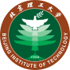

# 📚 Education

  
  

    

      <strong>Beijing Institute of Technology</strong>, Beijing, China (Sep. 2024–Present)
    

    

      M.Eng. in Electronic Information (Biomedical Engineering), in progress
    

  

  
  

    

      <strong>Southwest University</strong>, Chongqing, China (Sep. 2020–Jun. 2024)
    

    

      B.Eng. in Data Science and Big Data Technology
    

  

