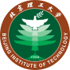

# 📚 教育经历

  
  

    

      <strong>北京理工大学</strong>，中国北京（2024 年 9 月至今）
    

    

      电子信息硕士研究生（生物医学工程方向），在读
    

  

  
  

    

      <strong>西南大学</strong>，中国重庆（2020 年 9 月至 2024 年 6 月）
    

    

      数据科学与大数据技术专业，工学学士
    

  

